<div align="center">

[](assets/hero.svg)

[+%F0%9F%8F%86;2%2C000%2B+Problems+Solved+%7C+Rating+up+to+1900;Python+%7C+Django+%7C+SQL+%7C+REST+APIs;Building+data-driven+%26+AI-powered+systems;Built+to+last+like+the+pyramids+%F0%9F%94%BA)](https://git.io/typing-svg)


[](https://www.linkedin.com/in/zeinab-43727b300)
[](mailto:zeinabdiab821@gmail.com)
[](https://github.com/ZeinabDiab)
[](https://wa.me/201554692141)


</div>

---

## ☥ About Me — The Scribe's Papyrus

```python
class Zeinab(Pharaoh):
    role      = "Backend & Software Developer"
    studying  = "CS & AI — Information Systems"
    achievements = [
        "🏆 ECPC Finalist 2025 & 2026",
        "🥉 3rd Place USC — ECPC Final 2026",
        "🧮 2,000+ problems solved",
        "📈 Competitive rating up to 1900",
    ]
    loves = ["Algorithms", "Databases", "Django", "AI"]
    mentoring = ["Competitive Programming", "Cybersecurity"]

    def mission(self):
        return "Turn complex problems into clean systems."
```

<div align="center">


</div>

> 👑 **Ramses II, "the Great"** ruled Egypt for about 66 years (c. 1279–1213 BCE). He raised Abu Simbel, fought at Kadesh, and later signed one of the earliest recorded peace treaties in history — monuments, strategy, and a clean agreement between two systems. That's my kind of engineering.

<div align="center">

[](assets/divider.svg)

</div>

## ⚒️ Tech Stack — The Royal Toolkit

<div align="center">

[](https://skillicons.dev)


</div>

**📚 Full skills breakdown**

| Area              | Skills                                                                                                                                            |
| ----------------- | ------------------------------------------------------------------------------------------------------------------------------------------------- |
| **Languages**     | Python · C++ · JavaScript · SQL                                                                                                                   |
| **Backend & Web** | Django · REST APIs · HTML · CSS · JavaScript                                                                                                      |
| **Databases**     | PostgreSQL · SQL Server · SQLite · T-SQL · PL/SQL · ER Modeling · Normalization · Relational Algebra · Query Processing · Transactions · Indexing |
| **CS Core**       | DSA · OOP · Complexity Analysis · DBMS · Operating Systems · Computer Networks · Software Engineering                                             |
| **Data & AI**     | Pandas · NumPy · Matplotlib · Power BI · Tableau · Data Processing & Visualization                                                                |
| **Tools**         | Git · GitHub · Linux · Figma                                                                                                                      |
| **Practices**     | Unit Testing · Agile · Responsive Design · Prototyping                                                                                            |

<div align="center">

[](assets/divider.svg)

</div>

## 🏛️ Featured Projects — Monuments Built

### 🧠 [Aletheia](https://github.com/ZeinabDiab/Aletheia)

**AI-Powered Social Intelligence & Recruitment Platform**


- 6 interconnected intelligence modules
- CV & job-description analysis, skill extraction, candidate ranking and skill-gap detection
- Sentiment, topic and trend analysis with privacy-aware data handling
- Modular Django architecture (auth, analysis, chatbot, dashboard, study management)

### 🗺️ [MindMap AI](https://github.com/ZeinabDiab/mindmap_ai)

**Intelligent Knowledge & Study Management System**


- 6 relational entities, 11 core operations
- BFS, DFS, Topological Sort and Priority Queue for learning paths
- Explainable rule-based recommendation engine
- Automated tests for graph, ordering and prerequisite logic

### ✈️ [Airport Database System](https://github.com/ZeinabDiab/Airport-Database-System)

**Relational DBMS Design & Implementation**


- 13 interconnected tables with PK, FK, composite keys and integrity constraints
- ER-to-relational mapping (1:N, M:N, self-referential)
- Views, stored procedures, functions and triggers
- Complex joins, subqueries, aggregation and relational algebra

### 🛍️ [Planet Accessories](https://planetaccessories.pythonanywhere.com)

**Freelance E-commerce Web App (Upwork)**


- Client-facing store for showcasing and selling accessories
- Database-driven product management and server-side logic
- Full integration of frontend, backend and database per client requirements

<div align="center">

[](assets/divider.svg)

</div>

## 📊 GitHub Stats — The Royal Chronicle

<div align="center">

[](https://github.com/ZeinabDiab)
[](https://github.com/ZeinabDiab)

[](https://github.com/ZeinabDiab)

[](https://github.com/ZeinabDiab)

</div>

<div align="center">

[](assets/divider.svg)

</div>

## 💼 Experience & Volunteering — Service to the Kingdom

| Role                                               | Highlights                                                                                                           |
| -------------------------------------------------- | -------------------------------------------------------------------------------------------------------------------- |
| 🧑‍💻 **Freelance Backend & Web Developer** — Upwork | Delivered a full Django e-commerce app, from business requirements to a live deployment                              |
| 🛡️ **Cybersecurity Mentor** — Volunteer            | Mentored junior students in web security, labs and CTFs, taking them from theory to practical vulnerability analysis |
| 🤝 **Seya** — Volunteer                             | Team collaboration, project planning and onboarding on vision, roadmap and workflow                                  |

## 🎓 Training — The House of Life

| Program                                      | Focus                                                                                  |
| -------------------------------------------- | -------------------------------------------------------------------------------------- |
| **Digital Egypt Pioneers Initiative (DEPI)** | Professional Data Analysis — SQL, Python, Pandas, NumPy, Matplotlib, Power BI, Tableau |
| **Information Technology Institute (ITI)**   | Backend Development with Python & Django — Database Integration                        |

## 🏆 Achievements — The Gold of Honor

| 🥉 | **3rd Place — USC, ECPC Final**                    | *August 2026*       |
| --- | -------------------------------------------------- | ------------------- |
| 🏅 | **4th Place — USC, ECPC Final**                    | *August 2025*       |
| 🧮 | **2,000+ competitive programming problems solved** | *Rating up to 1900* |

## 🌍 Languages — Tongues of the Nile

<div align="center">


[](assets/divider.svg)

[](https://raw.githubusercontent.com/ZeinabDiab/ZeinabDiab/output/github-snake-dark.svg)

### 📫 Let's connect — open to internships, collaborations & backend opportunities

[](mailto:zeinabdiab821@gmail.com)
[](https://www.linkedin.com/in/zeinab-43727b300)

<sub>☥ *Ankh, Udja, Seneb* — Life, Prosperity, Health ☥</sub>


</div>
